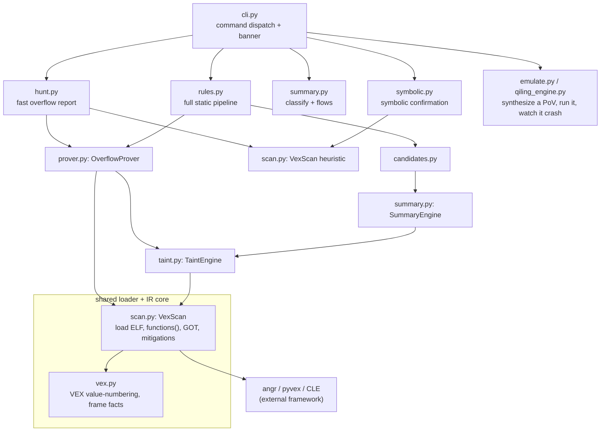

# Understanding VexHound

A guide for developers who can read code but have never done binary analysis,
reverse engineering, or vulnerability research. It starts with plain-language
explanations and builds up to the real implementation, using actual code,
functions, addresses, and IR from this repository.

Everything here is drawn from the code in `src/vexhound/` and the test binaries in
`tests/fixtures/`. Where a concept is not implemented, this guide says so rather
than inventing it.

## Table of contents

1. [What the project does](#1-what-the-project-does)
2. [Important concepts](#2-important-concepts)
3. [Architecture](#3-architecture)
4. [Setup](#4-setup)
5. [How to run it](#5-how-to-run-it)
6. [How the code works](#6-how-the-code-works)
7. [Binary to IR](#7-binary-to-ir)
8. [From IR to bug finding](#8-from-ir-to-bug-finding)
9. [Creating a bug candidate](#9-creating-a-bug-candidate)
10. [Bug verification](#10-bug-verification)
11. [Constraint verification](#11-constraint-verification)
12. [Path verification](#12-path-verification)
13. [Verification against the original binary](#13-verification-against-the-original-binary)
14. [Confirmed finding vs false positive](#14-confirmed-finding-vs-false-positive)
15. [Full vulnerability example](#15-full-vulnerability-example)
16. [Visualization (the terminal report)](#16-visualization-the-terminal-report)
17. [Visualization: design choices and limits](#17-visualization-design-choices-and-limits)
18. [False positives and false negatives](#18-false-positives-and-false-negatives)
19. [Debugging](#19-debugging)
20. [Testing](#20-testing)
21. [End-to-end mental model](#21-end-to-end-mental-model)

---

## 1. What the project does

**The problem.** Home routers, IP cameras and similar devices run small programs
(their "firmware") compiled to machine code for whatever CPU the device uses:
MIPS, ARM, PowerPC, and so on. A very common and serious bug in this kind of C
code is the **stack buffer overflow**: a function copies attacker-controlled data
(an HTTP header, a cookie, a form field) into a fixed-size buffer on the stack
without checking the length. A long input overruns the buffer and overwrites the
saved return address, which can hand control of the program to the attacker.

Finding these by hand means reading disassembly for every CPU dialect, which does
not scale. VexHound reads the compiled binary and looks for these bugs
automatically, and it does it once in a CPU-neutral way rather than per-CPU.

**Input.** One or more compiled ELF binaries (executables or shared libraries) for
any CPU that the [angr](https://angr.io) framework can load: MIPS, ARM, AArch64,
PowerPC, x86, x86-64, and more. In practice you point it at a binary extracted
from firmware, for example a router's `httpd` or `cgibin`.

**Output.** A ranked report of potential memory-safety issues: stack buffer
overflows (the main focus), plus supporting detection of command injection and
format-string bugs. Each finding names the function, the exact call site address,
the destination buffer offset, and how much room there is before the saved return
address. Findings can also be written to JSON or CSV.

**What it looks for.** Primarily: a dangerous copy (`strcpy`, `sprintf`, `memcpy`,
...) whose destination is a stack buffer and whose length can exceed the distance
from that buffer to the saved return address. Secondarily: shell commands built
from untrusted data (`system`, `popen`, `exec*`) and format strings that an
attacker controls.

**Start to finish.**

```text
Binary / Firmware
      |
      v  angr loads the ELF, picks the CPU, recovers functions
Disassembly
      |
      v  angr builds basic blocks and a control-flow graph
Basic Blocks / CFG
      |
      v  each block is lifted to VEX IR (a CPU-neutral instruction set)
IR
      |
      v  value-numbering, taint tracking, per-call overflow math
Data-flow / Security Analysis
      |
      v  a dangerous call into a stack buffer with attacker-reachable data
Potential Bug (candidate)
      |
      v  static rules, then symbolic execution / emulation
Verification
      |
      v
Confirmed Finding or False Positive
      |
      v  printed as a colored tree, or JSON/CSV
Visualization / Report
```

Each of these steps is explained in the sections below.

---

## 2. Important concepts

Small definitions first, so the rest of the guide reads smoothly.

- **Binary.** A compiled program file. VexHound works on ELF binaries (the format
  Linux and most firmware uses).

- **Machine code.** The raw bytes the CPU executes. Different CPUs use different
  machine code, which is why cross-CPU analysis is hard.

- **Assembly.** A human-readable text form of machine code, one line per
  instruction, for example `addiu $sp, $sp, -0x4e8` (MIPS: subtract 0x4e8 from the
  stack pointer).

- **Disassembly.** Turning machine-code bytes back into assembly. angr does this.

- **Function.** A named (or, in a stripped binary, unnamed) unit of code with an
  entry address, for example `hedwigcgi_main` at address `0x40bfc0`.

- **Basic block.** A straight run of instructions with one entry and one exit: no
  branches land in the middle, and it ends at the first branch or call. Programs
  are analyzed one basic block at a time.

- **Control Flow Graph (CFG).** A graph whose nodes are basic blocks and whose
  edges are the jumps/branches/calls between them. It captures "what can run after
  what."

- **Intermediate Representation (IR).** A simplified, CPU-neutral instruction set
  that machine code is translated ("lifted") into. VexHound uses **VEX IR** (the
  IR from the Valgrind project, exposed by angr's `pyvex`). One `strcpy` looks the
  same in VEX whether the CPU was MIPS or ARM.

- **SSA (Static Single Assignment).** A form where each temporary value is written
  exactly once. VEX temporaries (`t5`, `t6`, ...) are SSA within a single block,
  which is what makes them easy to track: if you see `t9 = Add32(t5, 0x4e4)`, `t9`
  has exactly that meaning for the rest of the block.

- **Variables and temporary values in IR.** VEX has registers (addressed by a
  numeric `offset`, for example the MIPS stack pointer is `offset=124`) and
  short-lived temporaries (`t0`, `t1`, ...). Real work happens through temporaries.

- **Control flow.** The order in which code can execute (captured by the CFG).

- **Data flow.** How a value moves and changes as it travels through instructions.

- **Source.** A place where untrusted data enters the program, for example a call
  to `getenv`, `recv`, or `fgets`.

- **Sink.** A dangerous operation that can become a vulnerability if fed the wrong
  data, for example `strcpy` or `system`.

- **Taint.** A label meaning "this value depends on untrusted input." If a source
  produces a tainted value and it flows to a sink, that is worth investigating.

- **Constraints.** Conditions that must hold on a path, for example `length < 64`.
  A constraint can make a dangerous-looking copy actually safe.

- **Vulnerability candidate.** A source-to-sink situation the analysis flags as
  worth checking. Not yet a proven bug.

- **False positive.** The tool reports a bug that is not real.

- **False negative.** A real bug the tool fails to report.

- **Verification.** Going beyond "this looks dangerous" to "can this actually
  happen?": checking reachability, constraints, and the real binary.

---

## 3. Architecture

VexHound is a Python package, `vexhound`, installed as a single command. It is a
**pipeline**: each stage is one module, is runnable on its own, and consumes the
stage before it. angr does the heavy lifting of loading, disassembling, building
the CFG, and lifting to VEX IR; VexHound's own code is the analysis on top.



**How they communicate.** Everything shares one loaded binary. `VexScan` (in
[`scan.py`](../src/vexhound/scan.py)) wraps the angr `Project`, recovers the
function inventory, parses the MIPS GOT, and detects mitigations. Every other stage
takes a `VexScan` so the binary is lifted and its CFG built exactly once per run.

**External tools.** angr (which pulls in `pyvex` for the IR, `cle` for loading,
`claripy` + z3 for constraints, `archinfo` for CPU details), `networkx` for the
call graph, `pyelftools` for reading ELF tables directly. Qiling is optional and
only used by one emulation mode.

**Intermediate files.** None are required. The pipeline passes Python objects
between stages in memory. You can optionally export findings to JSON or CSV
(`--json`, `--csv`), and there is a git-ignored `samples/` tree for large local
inputs, but the core analysis writes nothing to disk.

**Analysis pipeline vs visualization pipeline.** The analysis pipeline is the
stages above. The "visualization pipeline" is simpler than the name suggests:
there is no graph renderer. Output is a colored, tree-structured terminal report
built by [`banner.py`](../src/vexhound/banner.py) helpers. See section 16.

---

## 4. Setup

**Python.** 3.9 or newer (`requires-python = ">=3.9"` in
[`pyproject.toml`](../pyproject.toml)).

**Virtual environment and install.**

```bash
git clone <this repo>
cd Lifting            # the project root (package name is "vexhound")
python3 -m venv venv
source venv/bin/activate
pip install -e .
```

That installs the runtime dependencies (`angr>=9.2`, `networkx>=2.6`,
`pyelftools>=0.29`) and the `vexhound` command.

**Optional extras.**

```bash
pip install -e ".[emulation]"   # adds Qiling, for the qiling emulation engine
pip install -e ".[dev]"         # adds pytest + ruff, for development
```

**External tools (only for the `emulate` stage).** The qemu-user runner uses
`qemu-<arch>-static` and (on native x86-64) `gdb`; the Qiling engine needs the
target's extracted firmware root filesystem. None of these are needed for the
static analysis (`hunt`, `scan`, `classify`, `confirm`).

**Environment variables.**

- `NO_COLOR` disables colored output.
- `VEXHOUND_SAMPLES` points the sample locator at a directory of larger, local-only
  binaries.
- `VEX_EXPLAIN=1` makes the prover narrate its reasoning step by step (equivalent to
  the prover's `--explain`).

**Verify the installation.**

```bash
vexhound --version                 # prints "vexhound 0.1.0"
vexhound --help                    # lists the subcommands
python -m pytest -q                # runs the test suite against tests/fixtures/
```

The `unicornlib.so` warning some angr versions print at import is harmless; the
static analysis never uses the Unicorn engine.

---

## 5. How to run it

The main command is `vexhound <subcommand> <binary...>`. Every subcommand is also
runnable directly as `python -m vexhound.<module>`.

| Subcommand | Module | What it does |
|---|---|---|
| `hunt` | `hunt.py` | Fast, static overflow report (the one most people use). |
| `scan` | `rules.py` | Full static pipeline with a per-candidate verdict. |
| `classify` | `summary.py` | Label functions SOURCE/SINK/PROPAGATOR and list flows. |
| `confirm` | `symbolic.py` | Symbolically confirm a candidate (reachability + trigger). |
| `emulate` | `emulate.py` / `qiling_engine.py` | Synthesize a De Bruijn PoV, run it, observe the crash. |

**Important flags.**

- `--overflows-only` (hunt): hide command-injection / format-string rows.
- `--json FILE`, `--csv FILE` (hunt, scan): export findings.
- `--func`, `--sink`, `--arg`, `--budget` (confirm): target one call site.
- `--engine {qemu,qiling}`, `--rootfs DIR` (emulate): choose the runner.
- Global: `--no-color`, `--no-banner`, `-v/--verbose` (do not silence angr logging).

**A complete example** (the flagship D-Link DIR-645 `cgibin`, shipped as a test
fixture):

```bash
vexhound hunt --overflows-only tests/fixtures/dir645_cgibin_mipsle
```

Real output (abbreviated), rendered as a tree grouped by function:

```text
─── dir645_cgibin_mipsle ─────────────────────────────────
  arch MIPS32   mitigations canary ✗ · nx ✗ · pie ✗ · relro none
  hedwigcgi_main
  ├─ CRITICAL sprintf@0x40c1c0   CONFIRMED  proven
  │  dest sp+0xc0  room 0x424  size sym
  │  unbounded sprintf into stack buffer sp+0xc0; attacker sets length; only 0x424 bytes to saved ra
  └─ CRITICAL sprintf@0x40c4bc   CONFIRMED  proven
     ...
  ── 37 proven · 11 heuristic · 7 suppressed
```

**Where results go.** To your terminal by default; to files with `--json`/`--csv`.
Nothing else is written.

**Verbose / debug.** Add `-v` to keep angr's own logging visible, or set
`VEX_EXPLAIN=1` to make the prover print, for each dangerous call, the frame facts
it recovered and the decision it made.

---

## 6. How the code works

Each module, what it consumes and produces, and why it exists.

**`cli.py` (command dispatch).** Parses arguments, enables color when stdout is a
real terminal, prints the banner, and dispatches to the chosen stage. Input:
argv. Output: an exit code. It is the entry point for the `vexhound` command.

**`banner.py` (presentation).** The pixel-art startup logo plus the shared UI
toolkit: color helpers, box-drawing tree/rule glyphs (with an ASCII fallback), and
a severity label. Every list-heavy stage uses it so output is consistent and
degrades cleanly when piped.

**`scan.py` (`VexScan`: the shared loader, plus the recall heuristic).** This is
the foundation every other stage builds on. `VexScan.__init__` opens the binary
with angr, records register offsets and argument registers, parses the MIPS GOT
(`_load_mips_got`), and detects mitigations (`elf_mitigations`). Two methods matter
a lot:
- `functions()` returns the analysis inventory as `(name, entry, span)` tuples,
  covering both symbolized and anonymous/stripped functions, each bounded by the
  next function's entry. This is CFG-driven, not symbol-table-driven, so it sees
  the many unnamed helper functions where real sinks often live.
- `function_blocks(addr, span)` returns the basic-block start addresses of one
  function, sliced from the CFG's block boundaries within `[addr, addr+span)`.

`VexScan.run()` also implements the presence **heuristic** detector: it flags a
function when a dangerous-sink name and an input-getter name co-occur. It is the
broad "recall" layer that catches cases the precise prover cannot model (for
example x86-64 frames).

**`vex.py` (VEX value-numbering and frame facts).** The mathematical core.
`BlockV` turns any VEX address/value expression into a linear form
`(offset, coeff, unknown, frame_rel)` measured from the frame stack pointer.
`scan_function` runs that over every block of a function and recovers the frame
size, the saved-return-address slot (`ra_slot`), the resolved names of called
functions, and which stack offsets were passed as the first argument. Everyone
depends on this.

**`taint.py` (`TaintEngine`: does attacker data reach the sink?).** A forward
data-flow analysis over the IR that labels values derived from input sources and
propagates the labels to a fixed point over the function's blocks. When a tainted
value reaches a sink, that `(call, sink)` pair is a hit. The prover uses this to
upgrade a finding to CONFIRMED.

**`prover.py` (`OverflowProver`: the precise per-call prover).** For each
dangerous call it recovers the destination buffer offset `D`, computes
`room = ra_slot - D`, recovers the copy length when it is a constant, and decides
OVERFLOW / SAFE / CANDIDATE / NOT_STACK / UNMODELED. This is what turns "there is a
`memcpy` here" into "this `memcpy` writes 0x11 bytes into a buffer with 0x4cc bytes
of room, so it is safe." It uses `TaintEngine` as its reachability oracle.

**`hunt.py` (the fast report).** Runs the prover and the heuristic and merges them
per function: a proven overflow becomes a PROVEN row (CONFIRMED if taint reaches
it); a heuristic hit on a function the prover proved entirely safe is suppressed; a
heuristic hit where the prover could not model the frame is kept as a HEURISTIC
row. It prints the tree report and can export JSON/CSV.

**`summary.py` (`SummaryEngine`: classification + inter-procedural flows).**
Automatically labels every function SOURCE / SINK / PROPAGATOR / NEUTRAL by
computing a per-function summary and propagating it bottom-up over the call graph,
then records source-to-sink flow candidates. This is the `classify` command and
the first stage of the deep pipeline.

**`candidates.py` (compose + rank).** Turns the raw flows from `summary.py` into a
deduplicated, scored, ranked candidate list, adding the call-graph path from an
entry handler down to each sink.

**`rules.py` (`RuleEngine`: per-class static verdict).** Consumes the ranked
candidates and gives each a verdict: CONFIRMED, NEEDS_SYMBOLIC, or REFUTED. For
overflow candidates it reuses the prover's verdict; for command injection it
checks whether the tainted argument is the command argument; and so on. This is the
`scan` command.

**`symbolic.py` (targeted symbolic confirmation).** The `confirm` command. Starts
angr's symbolic execution at the sink's containing function, models input
primitives so they return symbolic ("attacker") bytes tagged with a taint
annotation, and explores toward the sink. If a path reaches it with an
attacker-derived argument, it reports CONFIRMED_SYM and can solve a concrete
sample. This uses claripy and z3 (an SMT solver) under the hood.

**Proof-of-vulnerability synthesis (in `emulate.py`).** Builds a crash-triggering
input using a De Bruijn pattern (every window is unique, so the crash reveals the
exact offset). Used by the `emulate` command.

**`emulate.py` / `qiling_engine.py` (dynamic confirmation).** Actually run the
crafted input, under the host CPU or a qemu-user emulator (`emulate.py`) or under
Qiling for socket daemons (`qiling_engine.py`), and observe the crash signal and
offset. The `emulate` command.

---

## 7. Binary to IR

**Why not analyze assembly directly?** Assembly is different for every CPU, has
hundreds of instructions with side effects (flags, delay slots, addressing modes),
and hides data flow inside register names and memory. Writing overflow logic once
per CPU does not scale, and reasoning about `mov`/`lw`/`ldr` variants is
error-prone.

**Why IR helps.** VEX IR is a small, regular instruction set. Every instruction
becomes a few explicit typed operations. Endianness is an explicit opcode, not a
special case. Registers become numbered slots, memory access is explicit, and
temporaries make data flow visible.

**Your illustrative example**, in the VEX style this project reads:

```text
Assembly:
    mov eax, [user_input]
    add eax, 10
    mov [buffer_index], eax

VEX-style IR:
    t0 = LDle:I32(user_input)      ; load 32-bit little-endian from memory
    t1 = Add32(t0, 0x0000000a)     ; add 10
    STle(buffer_index) = t1        ; store back to memory
```

Notice: the load and store are explicit `LD`/`ST` operations, the width and
endianness are in the opcode (`le`, `I32`), and the arithmetic flows through
single-assignment temporaries `t0`, `t1`.

**A real example from this project.** Here is the actual VEX IR of the prologue of
`hedwigcgi_main` at `0x40bfc0` in `tests/fixtures/dir645_cgibin_mipsle`, exactly as
`pyvex` produces it:

```text
------ IMark(0x40bfc0, 4, 0) ------
------ IMark(0x40bfc4, 4, 0) ------
t6 = GET:I32(offset=124)         ; read the stack pointer (sp is register offset 124)
t5 = Add32(t6, 0xfffffb18)       ; sp + (-0x4e8): allocate a 0x4e8-byte frame
PUT(offset=124) = t5             ; sp is now the frame pointer
------ IMark(0x40bfc8, 4, 0) ------
PUT(offset=120) = 0x0043b6d0     ; set gp (register 120) to a constant
------ IMark(0x40bfcc, 4, 0) ------
t9  = Add32(t5, 0x000004e4)      ; frame sp + 0x4e4
t11 = GET:I32(offset=132)        ; read the return address (ra is register 132)
STle(t9) = t11                   ; save ra at sp+0x4e4  ->  this is the ra_slot
------ IMark(0x40bfd0, 4, 0) ------
t12 = Add32(t5, 0x000004e0)
t14 = GET:I32(offset=128)        ; fp (register 128)
STle(t12) = t14                  ; save fp at sp+0x4e0
```

Reading this the way VexHound does:

- **`IMark`** records the original machine instruction (address and length), which
  is how the IR stays linked back to the binary (see section 13).
- **Registers become numbered slots.** For this MIPS32 little-endian binary,
  `sp=124`, `gp=120`, `ra=132`, `fp=128`, and the argument registers are
  `a0=24, a1=28, a2=32, a3=36`. VexHound never hardcodes `$sp`; it works with these
  offsets, which is what makes it CPU-neutral.
- **Memory access is explicit.** `STle(t9) = t11` is "store `t11` to the address in
  `t9`, little-endian." `t9 = frame sp + 0x4e4`, so this stores the return address
  at frame offset `0x4e4`. That offset, `ra_slot = 0x4e4`, is a fact the analysis
  needs.
- **Frame size falls out of arithmetic.** `0xfffffb18` is `-0x4e8` as a signed
  32-bit value, so the frame is `0x4e8` bytes.
- **Branches / block connections.** Each block ends with a `next` target and a
  `jumpkind` (`Ijk_Boring` for a plain jump, `Ijk_Call` for a call). The CFG
  connects blocks using these.

The one thing VEX does **not** contain is names: the IR has an address to call, not
the string `sprintf`. VexHound recovers names from the ELF's linker tables (symbol
table, PLT, and on MIPS the GOT), which is the same information the operating
system's loader uses to wire up calls.

---

## 8. From IR to bug finding

Going from "IR exists" to "bug found" is many small steps. Here is the path, then
each part.

```text
IR
 |
 v  find interesting operations (calls to known sinks)
Identify interesting operations
 |
 v  linear value-numbering: what is each register/temporary?
Track values
 |
 v  taint analysis: which values came from input?
Follow data flow
 |
 v  input primitives (getenv/recv/fgets/...) are the sources
Identify attacker-controlled input
 |
 v  propagate taint through temporaries, registers, memory slots
Follow input through transformations
 |
 v  the tainted value is an argument to a dangerous call
Reach dangerous operation
 |
 v  recover dest offset + copy length; compute room; check constraints
Evaluate conditions / constraints
 |
 v
Create vulnerability candidate
```

### 8.1 Reading the IR

The analysis walks each function's basic blocks in address order and, per block,
processes the VEX statements. It specifically looks at:

- **Register writes/reads** (`PUT(offset=...)`, `GET:I32(offset=...)`) to track what
  each register holds.
- **Arithmetic** (`Add32`, `Sub32`, `Shl32`, `Mul32`) to fold stack-pointer offsets
  and constants. `vex.py` handles exactly these and marks anything else `unknown`
  rather than guessing.
- **Memory stores/loads** (`STle`/`STbe`, `LDle`/`LDbe`) to find the saved-ra store
  and to move constants and taint through stack slots.
- **Calls** (`jumpkind` `Ijk_Call`, with the target in `next`) to identify sink
  calls and getter calls, resolving the target to a name via GOT/PLT/symbol.
- **Pointer/frame math**: the case where a register becomes `sp + K` (a stack
  buffer pointer) or a constant (a size argument or a global address).

It does **not** try to interpret every instruction. Multiplies of unknowns, bit
tricks, and loads it cannot resolve are left `unknown`, and an `unknown` never
produces a finding on its own. This keeps false positives from arithmetic guessing
low.

### 8.2 Sources

A source is where untrusted data enters. VexHound hardcodes only the irreducible
input primitives (library functions it cannot see inside) and infers everything
else. The seed lists live in the code:

- `SOURCE_PRIM` in [`summary.py`](../src/vexhound/summary.py): `getenv`,
  `nvram_get`, `websGetVar`, `recv`, `recvfrom`, `read`, `fread`, `fgets`,
  `getline`, and similar. Some taint their return value (`getenv`); memory readers
  like `recv`/`read`/`fgets` taint the buffer they fill.
- `STRONG` in [`scan.py`](../src/vexhound/scan.py): the getter names the heuristic
  and taint engine treat as input, including firmware-specific ones like
  `sobj_get_string` and `cgibin_parse_request`.

Internally, "this came from input" is represented as a **taint label**. A memory
reader is modeled as: the bytes it wrote into its buffer are now tainted.

```text
network input
      |
      v  recv(sockfd, buf, len, flags)
buf is now tainted
```

### 8.3 Data-flow tracking

Taint is the label "this value depends on untrusted input." The `TaintEngine` in
[`taint.py`](../src/vexhound/taint.py) is a forward *may*-analysis: it propagates
labels forward through the IR and, at a branch join, takes the union of incoming
labels, iterating to a fixed point over the function's blocks.

Per block, in statement order, with def-kill semantics:

- a temporary becomes tainted if its expression reads a tainted temporary,
  register, or stack slot;
- a `PUT` sets or clears a register's taint;
- a `STle`/`LDle` moves taint through a known stack slot; a clean overwrite removes
  it.

So for the classic chain:

```text
input
 |
 v   v1 = source()          v1 tainted
 v   v2 = v1 + 4            v2 tainted (arithmetic on a tainted value)
 v   v3 = truncate(v2)      v3 tainted
 v   memory[v3] ...         the access depends on tainted v3
```

the engine knows `v3` still depends on the input because taint rode along through
each temporary. The `confirm` stage does the same thing more precisely using
**claripy annotations**: the symbolic "attacker" bytes carry a `TaintedAnnotation`
that claripy propagates automatically through every arithmetic and memory
operation, so "is this value attacker-derived?" is a sound query rather than a
name-matching guess.

Separately, the prover tracks *values* (not just taint) with linear
value-numbering in `vex.py`: it knows when a register holds `sp + K` (a stack
pointer) or a constant. That is how it recovers the destination buffer offset and
the copy length.

### 8.4 Control flow

Following data alone is not enough, because a condition can make a dangerous copy
safe:

```c
if (length < 64)
    memcpy(buffer, input, length);   // length is bounded here
```

Here `length` is attacker-influenced and reaches `memcpy`, but the guard limits it,
so (if `buffer` is at least 64 bytes) this is safe. Deciding that requires
understanding the branch, not just the data.

VexHound handles this at two levels. Statically, the prover reasons about the copy
length as a value: if the length is a constant `n` it compares `n` to the room
(section 9); if the length is non-constant it only calls it an overflow when taint
shows the length itself is attacker-influenced. Dynamically, the `confirm` stage
uses the CFG and the branch conditions directly: symbolic execution only follows
feasible paths, and the guard becomes a constraint the SMT solver must satisfy to
reach the sink (sections 11 and 12).

### 8.5 Dangerous operations / sinks

The sinks VexHound recognizes are listed in code:

- Overflow sinks, with which argument is the destination and which is the length,
  in `UNBOUNDED_SINKS` and `BOUNDED_SINKS` in
  [`prover.py`](../src/vexhound/prover.py): `strcpy`, `strcat`, `sprintf`, `gets`,
  `stpcpy`, `vsprintf` (unbounded, attacker sets the length); `strncpy`, `memcpy`,
  `memmove`, `snprintf`, `fgets`, `read`, `recv` (bounded by a size argument).
- Command-injection sinks (`system`, `popen`, `execl`, ...) and format-string
  sinks (`printf`, `sprintf`, ...) in `scan.py` and `summary.py`.

**Reaching a sink is not proof of a bug.** A `memcpy` is only dangerous if its
destination is a stack buffer and its length can exceed the room to the saved
return address. A `system` call is only dangerous if the command is
attacker-controlled and unsanitized. That gap between "reached a sink" and "is
actually exploitable" is exactly what the rest of the pipeline exists to close.

---

## 9. Creating a bug candidate

A candidate is created when a source-to-sink situation is dangerous *and* the
numbers work out. The precise prover in `prover.py` is where the overflow decision
is made. For each dangerous call it computes three facts from the IR:

- **`D`**: the destination buffer's offset within the stack frame (the argument
  register holds `sp + D`).
- **`room = ra_slot - D`**: how many bytes lie between that buffer and the saved
  return address.
- **`n`**: the number of bytes the call writes, as a constant when the compiler
  used a fixed size, or "symbolic" for unbounded copies.

The decision table (from `_check_call`):

| Sink kind | Condition | Verdict |
|---|---|---|
| unbounded (`strcpy`, `sprintf`, ...) into a stack buffer | attacker sets length | **OVERFLOW** (CRITICAL if `room < 0x600`, else HIGH) |
| bounded, constant `n` | `n > room` | **OVERFLOW** (`n - room` bytes past ra) |
| bounded, constant `n` | `n <= room` | **SAFE** (proven to fit, suppressed) |
| bounded, non-constant `n` | length is attacker-tainted | **OVERFLOW** (unchecked length) |
| bounded, non-constant `n` | untainted | **CANDIDATE** (unproven) |
| dest is a constant global address | (any) | **NOT_STACK** (not a stack overflow) |
| no `ra_slot`, or `D` not recoverable | (any) | **UNMODELED** (defer to heuristic) |

A finding is upgraded to **CONFIRMED** when the taint engine shows attacker input
reaches that specific call; otherwise it stays a candidate.

The deep pipeline (`summary.py` -> `candidates.py`) additionally scores and ranks
candidates so the expensive later stages look at the most promising first: weights
per bug class, a bonus for unbounded sinks, a bonus for network-facing sources, and
a bonus if the sink is reachable from an entry handler (`CLASS_W`, `NET_SRC`, and
the `build()` method in `candidates.py`).

Your illustrative dangerous pattern:

```text
User input
   |
   v   length = recv(...)
   v   n = length + 20
   v   memcpy(destination, input, n)
```

is dangerous because `n` is attacker-influenced and larger than the raw input
length, so even a "bounded" `memcpy` can overrun `destination`. VexHound flags this
when the length argument is non-constant and taint reaches the call.

---

## 10. Bug verification

Detection and verification are different questions:

```text
Detection    = "this looks dangerous"
Verification = "can this dangerous situation actually happen?"
```

VexHound verifies at increasing cost:

1. **Static rule verdict (`rules.py`).** Cheap. Reuses the prover's proof: an
   OVERFLOW is CONFIRMED, a SAFE or NOT_STACK is REFUTED, anything undecided is
   routed to NEEDS_SYMBOLIC. Command-injection is confirmed when the tainted
   argument is the command argument; a format string is confirmed when the tainted
   argument is the format argument itself (not just a data argument).

2. **Symbolic confirmation (`symbolic.py`).** For the NEEDS_SYMBOLIC survivors.
   angr executes the containing function symbolically, models input primitives to
   return tainted symbolic bytes, and explores toward the sink. It reports
   CONFIRMED_SYM (reached with an attacker-derived argument), REACHED_TAINTED
   (reached on a taint-consuming path but the argument was concretized by a model),
   REACHED, or UNCONFIRMED. This uses claripy + z3 for constraints.

3. **Proof-of-vulnerability + emulation (`emulate.py`,
   `qiling_engine.py`).** Build a De Bruijn input and actually run the binary
   (native, qemu-user, or Qiling), then observe the crash signal and recover the
   overflow offset. A real SIGSEGV landing where the pattern predicts is the
   strongest evidence.

4. **Manual verification against the original binary (section 13).** The tool
   reports the real call-site address, so a researcher can open it in a
   disassembler and confirm.

Not every mechanism runs every time: `hunt` uses (1)'s prover directly, `scan` runs
(1), `confirm` runs (2), and `emulate` runs (3). There is no built-in Ghidra
integration; (4) is something you do by hand, made possible by the reported
addresses.

---

## 11. Constraint verification

A constraint is a condition that must hold on a path. Constraints are what turn a
scary-looking copy into a false positive, or fail to.

**Case A: the constraint makes it safe.**

```c
if (size <= 32)
    memcpy(dst, src, size);   // dst is 64 bytes
```

A data-flow-only view reports "untrusted `size` reaches `memcpy`." But `size <= 32`
and `dst` has room, so it is safe. VexHound's static prover handles the common form
of this directly: if `size` is a constant it compares it to the room and marks the
copy SAFE when it fits (the `n <= room -> SAFE` row). For the real DIR-645 `cgibin`
this suppresses genuine safe copies, for example a `memcpy` of `0x11` bytes into a
buffer with `0x4cc` bytes of room.

When the guard is a runtime condition rather than a constant size, the `confirm`
stage handles it: to reach the sink, symbolic execution must satisfy the branch
condition, so `size <= 32` becomes a constraint added to the path. If the solver
cannot make `size` large enough to overflow while also satisfying `size <= 32`, the
path to a dangerous value is infeasible and the finding is not confirmed.

**Case B: the constraint does not make it safe.**

```c
if (size <= 1024)
    memcpy(buffer_64_bytes, src, size);   // 1024 > 64
```

Here the guard allows `size` up to 1024, but `buffer` is only 64 bytes, so `size`
between 65 and 1024 overflows. Statically, the prover sees `room = 64` and, if the
length is a constant greater than 64, reports OVERFLOW; if the length is non-constant
and tainted, it reports OVERFLOW (unchecked length). Symbolically, the solver can
satisfy `size <= 1024 AND size > 64`, so a dangerous, reachable value exists and the
finding stands.

The point: a guard is only protective if it actually bounds the value below the
buffer size. VexHound reasons about the numbers rather than assuming any check is
sufficient.

---

## 12. Path verification

A dangerous sequence only matters if the path to it is actually reachable with the
required conditions all true at once.

```text
Entry
 |
 v
Block A
 |
 v  condition
 |\
 | \
 B  C
    |
    v
 dangerous call
```

To reach the dangerous call you must go A -> C (not A -> B), and the condition on
that edge must be satisfiable together with everything else on the path. The
`confirm` stage answers this concretely: it starts a symbolic state at the function
entry and explores the CFG; a state that arrives at the sink address carries the
exact set of branch conditions it took to get there, as constraints. If those
constraints are jointly unsatisfiable, no real input drives that path and the sink
is not truly reachable. The exploration is budgeted (time and step limits) and
biased toward states closest to the sink so the budget is spent walking toward the
target rather than wandering.

---

## 13. Verification against the original binary

Every finding can be mapped back to a concrete place in the binary, because the IR
never loses the link:

```text
Finding
  |
  v  the finding records the call-site address (the "site" field)
IR instruction (the Ijk_Call block, e.g. jalr)
  |
  v  IMark ties each IR statement to a machine instruction
Basic block
  |
  v
Machine instruction (e.g. jalr $t9 at 0x40c1c0)
  |
  v
Binary address (0x40c1c0)
  |
  v
Function (hedwigcgi_main, entry 0x40bfc0)
```

VexHound reports two addresses per proven finding: the internal block address
(`addr`, used to pair with the taint result) and the **actual call instruction
address** (`site`, shown to you). For the hedwig `sprintf` the reported `site` is
`0x40c1c0`, which is the real `jalr $t9` that calls `sprintf`, not the start of the
post-call block. That means you can open `0x40c1c0` in Ghidra (or any disassembler)
and see exactly the instruction VexHound is talking about, and the enclosing
function `hedwigcgi_main`.

This is how the findings in this repository were validated: loading
`dir645_cgibin_mipsle` into Ghidra headless, listing function boundaries, and
confirming that each reported `site` sits in the function VexHound named and is a
real call to the reported sink. Because the tool emits genuine addresses, "why did
it report this?" is always answerable by looking at that address in the binary.

---

## 14. Confirmed finding vs false positive

The final classification is the funnel of the checks above:

```text
Candidate
   |
   v  data-flow valid?  (taint reaches the sink)
   v  path reachable?   (symbolic exploration reaches the sink addr)
   v  safety check?     (prover: bounded copy that fits -> SAFE/REFUTED)
   v  constraint permits a dangerous value?  (solver satisfies guard AND overflow)
   v  original binary matches?  (the reported site is that call)
   |
   v
Confirmed  /  Rejected  /  Needs Manual Review
```

- **Confirmed**: OVERFLOW with taint reaching it (CONFIRMED), or CONFIRMED_SYM from
  symbolic execution, or a real crash from emulation.
- **Rejected**: the prover proved it SAFE (bounded copy fits) or NOT_STACK (global
  destination), so `rules.py` marks it REFUTED.
- **Needs manual review**: the frame could not be modeled (UNMODELED, deferred to
  the heuristic) or symbolic execution ran out of budget (UNCONFIRMED).

What is saved for each result: the function name, the call-site address, the sink,
the destination offset and room, the size (constant or symbolic), the severity, the
taint/verdict, the mitigations of the binary, and a human-readable reason. With
`--json`/`--csv` all of this is written out per finding.

---

## 15. Full vulnerability example

The D-Link DIR-645 `hedwig.cgi` overflow, end to end, on
`tests/fixtures/dir645_cgibin_mipsle` (MIPS32 little-endian). This is a real,
publicly known CVE, which is why it is the flagship test case.

```text
Original binary: dir645_cgibin_mipsle  (MIPS32 LE, stripped, .dynsym present)
      |
      v
Function: hedwigcgi_main @ 0x40bfc0
      |
      v  angr builds ~79 basic blocks and the CFG
Basic blocks / CFG
      |
      v  each block lifted to VEX IR (prologue shown in section 7)
IR
      |
      v  frame facts recovered by scan_function (vex.py):
         frame = 0x4e8,  ra_slot = 0x4e4  (from STle(sp+0x4e4) = GET(ra))
      |
      v  source identification (taint.py):
         the handler reads request data via fgets, then extracts a field via
         sobj_get_string  ->  the field pointer is tainted
Source identification
      |
      v  data-flow tracking (taint.py):
         flow: ['fgets', 'sobj_get_string'] -> sprintf   (call block 0x40c1a8)
Data-flow tracking
      |
      v  dangerous operation (prover.py):
         sprintf is unbounded; its destination arg (a0) is recovered as sp+0xc0;
         the real call instruction is jalr $t9 at 0x40c1c0
Dangerous operation
      |
      v  bug candidate (prover.py):
         room = ra_slot - D = 0x4e4 - 0xc0 = 0x424
         unbounded sprintf into sp+0xc0 with only 0x424 bytes to the saved ra
         verdict OVERFLOW, severity CRITICAL (room < 0x600), taint reaches it
Bug candidate
      |
      v  constraint / path verification (symbolic.py):
         vexhound confirm ... --func 0x40bfc0 --sink 0x40c1a8 --arg 0
         result: CONFIRMED_SYM (~10s) reached 0x40c1a8 with arg0 attacker-controlled
Verification
      |
      v  original-binary verification (section 13):
         open 0x40c1c0 in Ghidra -> it is `jalr $t9` calling sprintf, inside
         hedwigcgi_main; a0 = sp+0xc0 set in the delay slot
Original binary verification
      |
      v
Confirmed finding
```

The reported line:

```text
  [PROVEN] CRITICAL stack-buffer-overflow  hedwigcgi_main  sprintf@0x40c1c0 CONFIRMED
        dest=sp+0xc0 size=sym room=0x424
        unbounded sprintf into stack buffer sp+0xc0; attacker sets length; only 0x424 bytes to saved ra
```

**Why it is real.** `sprintf` writes a formatted string with no length bound into a
stack buffer that sits only `0x424` bytes below the saved return address; the data
being formatted comes from the request (taint proves the flow); and symbolic
execution confirms a feasible path reaches the call with attacker-controlled data.
An input longer than `0x424` bytes overwrites the saved return address at
`sp+0x4e4`, which is exactly the byte distance a crash on real hardware reproduces
for this bug.

**Contrast: a safe copy in the same function.** `hedwigcgi_main` also contains a
`memcpy` of `0x11` bytes into a different stack buffer with `0x4cc` bytes of room.
The prover computes `n = 0x11 <= room = 0x4cc` and marks it SAFE, so it is
suppressed. A tool that only grepped for `memcpy` would report it as a false
positive; VexHound proves it fits.

---

## 16. Visualization (the terminal report)

**There is no graph renderer in VexHound.** It does not draw CFG or data-flow
images, and it does not depend on Graphviz or any plotting library. (`networkx` is
present, but only as an in-memory data structure for the call graph: shortest-path
from an entry handler to a sink, and topological ordering for bottom-up summaries.
Nothing is drawn.) The "visualization" is the colored, tree-structured terminal
report produced by the helpers in [`banner.py`](../src/vexhound/banner.py).

How to read the `hunt` report:

```text
─── dir645_cgibin_mipsle ─────────────────────────────────      <- section rule: the binary
  arch MIPS32   mitigations canary ✗ · nx ✗ · pie ✗ · relro none <- header: CPU + mitigations
  hedwigcgi_main                                                 <- a function (tree root)
  ├─ CRITICAL sprintf@0x40c1c0   CONFIRMED  proven               <- a finding (leaf)
  │  dest sp+0xc0  room 0x424  size sym                          <- the numbers behind it
  │  unbounded sprintf into stack buffer sp+0xc0; ...            <- the reason
  └─ CRITICAL sprintf@0x40c4bc   CONFIRMED  proven
  ── 37 proven · 11 heuristic · 7 suppressed                     <- per-binary summary
```

- **Tree structure.** Findings are grouped under their function. The function name
  is the node; each finding is a `├─`/`└─` leaf with its details indented under it.
  This groups related sinks and keeps the output scannable.
- **Sources and sinks.** The sink is shown as `name@address` (for example
  `sprintf@0x40c1c0`). The sources are not printed inline in `hunt`; the `classify`
  command lists source-to-sink flows explicitly, and the taint result is condensed
  into the `CONFIRMED` tag.
- **Severity color.** CRITICAL is red, HIGH is amber, MEDIUM/`-` are muted.
- **Confirmed vs candidate.** A confirmed finding shows a bold green `CONFIRMED`; an
  unverified one shows a muted `candidate`. The method (`proven` vs `heuristic`) is
  shown in muted text so you can tell precise findings from recall-layer ones.
- **Mitigations.** Shown as flags with check/cross marks; a present mitigation
  (for example a stack canary) is highlighted, which tells you how exploitable a
  proven overflow really is.

The `scan` command colors its per-class verdicts (confirmed red, needs-symbolic
amber, refuted green), and `classify` colors the role summary (SOURCE cyan, SINK
red, PROPAGATOR amber). All of this degrades to plain ASCII with no escape codes
when output is piped to a file, when `NO_COLOR` is set, or with `--no-color`.

---

## 17. Visualization: design choices and limits

Because there is no graphical visualization, this section documents the real design
decisions and their trade-offs rather than inventing rendering bugs that do not
exist in the project.

**Choice: a terminal report instead of a graph.**

```text
Want: show many findings across many functions, readably, in a terminal
 |
 v  a full CFG/data-flow graph image would be large and needs a viewer
Why a graph is awkward here
 |
 v  tried: group findings as a text tree under each function
What we did
 |
 v  result: scannable, greppable, works over SSH and in CI logs
Outcome
 |
 v  limitation: you cannot see the CFG shape or the full data-flow path
Remaining limitation
```

**Real limitation: the block address vs the call address.** angr ends a basic block
after a call, so the block that contains a call starts at the post-call fixup
instruction, not at the call. Early output reported that block-start address as the
"call site," which did not line up with a disassembler. The fix was to add a `site`
field that walks the block to the actual call instruction (the `jalr`/`bl`/`call`)
and show that, while keeping the block address internally for taint pairing. So the
report now shows `sprintf@0x40c1c0` (the real call) rather than `0x40c1a8` (the
block start). The connection between the report and the original assembly is
preserved by design.

**Real limitation: keeping IR findings tied to the binary.** The value shown to you
is always a genuine machine address (via `IMark`), so you can open it in Ghidra.
The trade-off is that the report shows addresses, not source lines: firmware is
stripped, so there is no source to point at, only functions and addresses.

**Real limitation: anonymous functions.** In a stripped binary most functions have
no name, so the report labels them `sub_<address>` (for example `sub_406990`).
That is less friendly than a real name, but it is honest and still points at a
precise location you can verify.

---

## 18. False positives and false negatives

For a beginner: a **false positive** is when the tool cries wolf (reports a bug that
is not real); a **false negative** is when it stays silent about a real bug. Static
binary analysis always trades these off against each other.

**Where false positives can come from in this project:**

```text
angr lifts an instruction wrongly (rare, but possible)
       |
       v
incorrect IR
       |
       v
incorrect value-numbering or taint
       |
       v
a copy that is actually safe looks dangerous
```

Concretely, the heuristic layer (`scan.py`) is deliberately broad: it flags a
function that merely contains a dangerous-sink name and an input-getter name. On its
own that over-reports. VexHound reduces these by running the precise prover and
**suppressing** heuristic hits on functions the prover proved entirely safe, and by
recognizing when a sink's destination is a global buffer (NOT_STACK) rather than the
stack, which stops a global-buffer `sprintf` from being mislabeled a stack overflow.

**Where false negatives can come from:**

```text
an instruction/addressing form the value-numbering marks "unknown"
       |
       v
the destination offset or length is not recovered
       |
       v
the prover cannot model the call (UNMODELED)
       |
       v
the bug is only caught by the heuristic, or missed entirely
```

Other honest gaps: taint is a may-analysis and is weak on data passed through
indirect (function-pointer) calls; symbolic confirmation is function-local, so a
CONFIRMED_SYM proves reachability within the function, not the whole path from the
network; and the frame-distance model does not fit x86-64 / AArch64 as cleanly as
MIPS/ARM32/PPC32, where those defer to the heuristic.

**How verification helps.** Every layer after detection exists to cut false
positives: the prover proves safe copies safe, `rules.py` refutes them, and
symbolic execution and emulation demand an actual feasible, crashing path before
the strongest labels are applied.

---

## 19. Debugging

A practical guide to common situations.

**Symptom: "no findings" on a binary you expect to be vulnerable.**
- Likely cause: call names are not resolving (so no sinks are seen), or the
  functions are not being enumerated.
- Investigate: check the function inventory and GOT.
  ```python
  from vexhound.scan import VexScan
  vs = VexScan("path/to/binary")
  print(len(vs.functions()), "functions")
  print(len(vs.got), "GOT entries")     # 0 on MIPS means call names will not resolve
  ```
- On MIPS shared objects specifically, an empty GOT used to mean every call was
  anonymous; if you see `got=0` on a `.so`, that is the thing to look at.

**Symptom: a finding is attributed to the wrong function.**
- Investigate: compare the reported `site` against the real function boundaries.
  A tiny (8-byte) function is usually a tail-jump thunk; the real code is the
  anonymous function it jumps to.
  ```bash
  readelf -sW binary | awk '$4=="FUNC" && $7!="UND"'   # symbol addresses and sizes
  ```
- Cross-check the containing function of an address in Ghidra headless (see below).

**Symptom: you do not understand why the prover made a decision.**
- Fix: turn on the explain trace, focused on one function.
  ```bash
  VEX_EXPLAIN=1 python -m vexhound.prover --explain --func hedwigcgi_main \
      tests/fixtures/dir645_cgibin_mipsle
  ```
  It prints the prologue IR, the recovered `frame`/`ra_slot`, the sinks it found,
  the taint result, and the room/size decision for each call.

**Symptom: you want to see the raw IR the analysis reads.**
- Inspect it directly with pyvex:
  ```python
  import angr
  p = angr.Project("tests/fixtures/dir645_cgibin_mipsle", auto_load_libs=False)
  print(p.factory.block(0x40bfc0).vex.pp())   # pretty-print the VEX of one block
  ```

**Symptom: you want to check VexHound against ground truth.**
- Use Ghidra headless to dump function boundaries and the containing function of an
  address, then compare. This repository was validated exactly this way. Note that
  Ghidra 12+ needs PyGhidra for Python post-scripts; a Java post-script always
  works.

**General: keep angr's logging visible** with `vexhound -v ...` when something
loads or lifts unexpectedly.

---

## 20. Testing

The tests live in [`tests/`](../tests/) and run against the small committed
binaries in [`tests/fixtures/`](../tests/fixtures/). The suite is the executable
specification of expected behavior.

**The fixtures and what each represents:**

| Fixture | Represents | Expected result |
|---|---|---|
| `dir645_cgibin_mipsle` | Real D-Link firmware (MIPS32 LE), the hedwig CVE | Proven overflows; the hedwig `sprintf` is taint-CONFIRMED |
| `clean_hello_mipsel` | A benign MIPS program | No proven overflow (a safe control) |
| `firm_sink_x86_64` | A synthetic handler with a planted overflow (x86-64) | Crashes under native emulation |
| `firm_sink_{armhf,aarch64,ppc32,mipsel}` | The same planted sink across CPUs | Cross-CPU sink recovery |
| `clean_hello_armel` | A benign ARM program | No proven overflow |
| `lib_mipsel_pic.so` | A MIPS PIC shared object | GOT resolves; call names decode |

**What the tests assert (from `tests/test_analysis.py` and `tests/test_cli.py`):**

- *Known vulnerable sample is detected.* `hunt(dir645_cgibin_mipsle)` returns at
  least one PROVEN overflow, and the hedwig `sprintf` finding is `tainted` (the
  CONFIRMED path works end to end).
- *Known safe sample is not reported.* `hunt(clean_hello_mipsel)` returns no PROVEN
  overflow.
- *Attribution is correct.* The anonymous shared function `sub_406990` is analyzed,
  and no finding is attributed to the 8-byte thunk `dlapn_main`.
- *The reported address is the call.* The hedwig `sprintf` `site` is `0x40c1c0`.
- *A global destination is not a stack overflow.* `soapcgi_main`'s `sprintf` (into a
  global buffer) is verdict NOT_STACK, and no stack-overflow row is emitted for it.
- *Shared-object GOT resolution works.* `lib_mipsel_pic.so` has a non-empty GOT that
  decodes to real libc names, and calls resolve through it.
- *The pipeline loads the binary once.* The full static pipeline constructs exactly
  one `VexScan`.
- *Native emulation crashes.* On an x86-64 host, firing the payload at
  `firm_sink_x86_64` produces a CRASH.
- *The De Bruijn helper locates offsets*, and the CLI exposes `--version`, `--help`,
  and every subcommand.

Run everything with `python -m pytest -q`. The angr-dependent tests
`importorskip("angr")`, so they skip cleanly if angr is not installed.

---

## 21. End-to-end mental model

The whole system in eleven steps:

```text
1.  Read the binary                         (angr / CLE loads the ELF, picks the CPU)
2.  Understand its instructions             (angr disassembles into basic blocks + CFG)
3.  Convert instructions into simpler IR    (pyvex lifts each block to VEX IR)
4.  Build program flow                      (the CFG connects blocks; functions() lists units)
5.  Find where untrusted data enters        (sources: getenv/recv/fgets/... in taint.py)
6.  Track where that data goes              (taint labels + linear value-numbering)
7.  Detect when it reaches something dangerous (sinks: strcpy/sprintf/system/...)
8.  Check whether the dangerous path is possible (prover math, then symbolic/emulation)
9.  Map the result back to the original binary   (the reported call-site address)
10. Confirm or reject the finding            (OVERFLOW+taint / SAFE / NOT_STACK / CONFIRMED_SYM)
11. Show the result visually                 (colored tree report in the terminal)
```

The key idea to remember: **IR is not the point; it is the means.** VexHound lifts
CPU-specific machine code into one neutral IR so it can, once, recover the facts a
memory-safety bug is made of (where the buffer is, how much room there is, how many
bytes get written, and whether the data is attacker-controlled). Detecting a
dangerous operation is only the beginning: the copy might be bounded, the path
might be unreachable, the destination might be a global rather than the stack. That
is why detection alone is never treated as a bug, and why the pipeline spends most
of its effort on verification: proving a copy safe, refuting it, or driving a real
input to a real crash, and always pointing back at an address you can open in a
disassembler and check for yourself.
